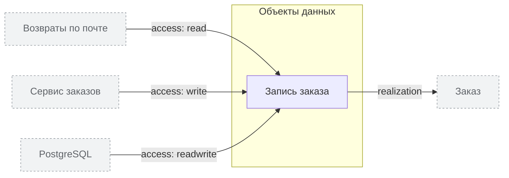

<!-- Сгенерировано командой rivet architecture views. Не редактируй вручную: файл перезаписывается. -->

# Данные

| Элемент | Тип | Название | Описание |
|---|---|---|---|
| `data.order` | data-object | Запись заказа |  |
