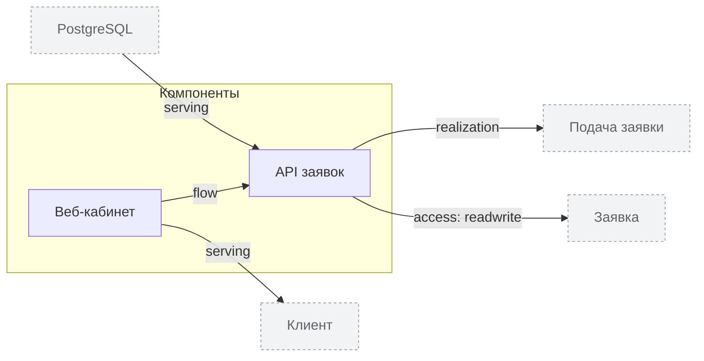

<!-- Сгенерировано командой rivet architecture views. Не редактируй вручную: файл перезаписывается. -->

# Приложения

| Элемент | Тип | Название | Описание |
|---|---|---|---|
| `app.api` | component | API заявок |  |
| `app.web` | component | Веб-кабинет | Страницы для клиентов |
