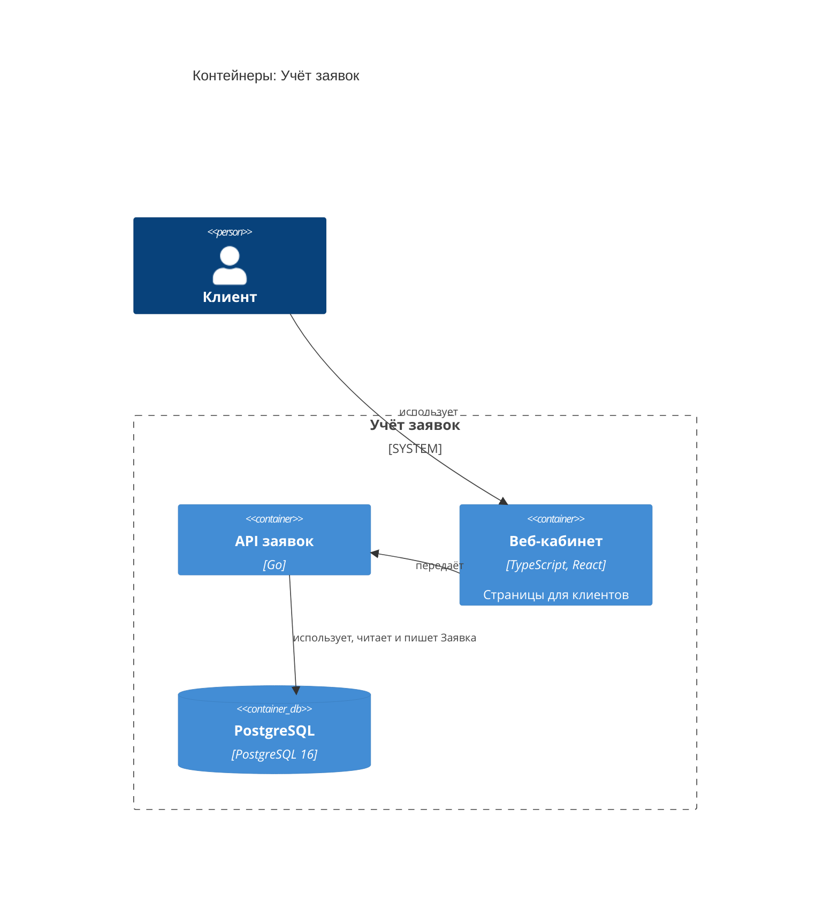

<!-- Сгенерировано командой rivet architecture views. Не редактируй вручную: файл перезаписывается. -->

# Контейнеры: Учёт заявок

- [Контекст](../context.md)

| Элемент | Название | Вид | Технология | Описание |
|---|---|---|---|---|
| `biz.client` | Клиент | человек |  |  |
| `system` | Учёт заявок | система |  | Принимает заявки клиентов и ведёт их до закрытия |
| `app.api` | API заявок | контейнер | Go |  |
| `app.web` | Веб-кабинет | контейнер | TypeScript, React | Страницы для клиентов |
| `tech.db` | PostgreSQL | база данных | PostgreSQL 16 |  |
