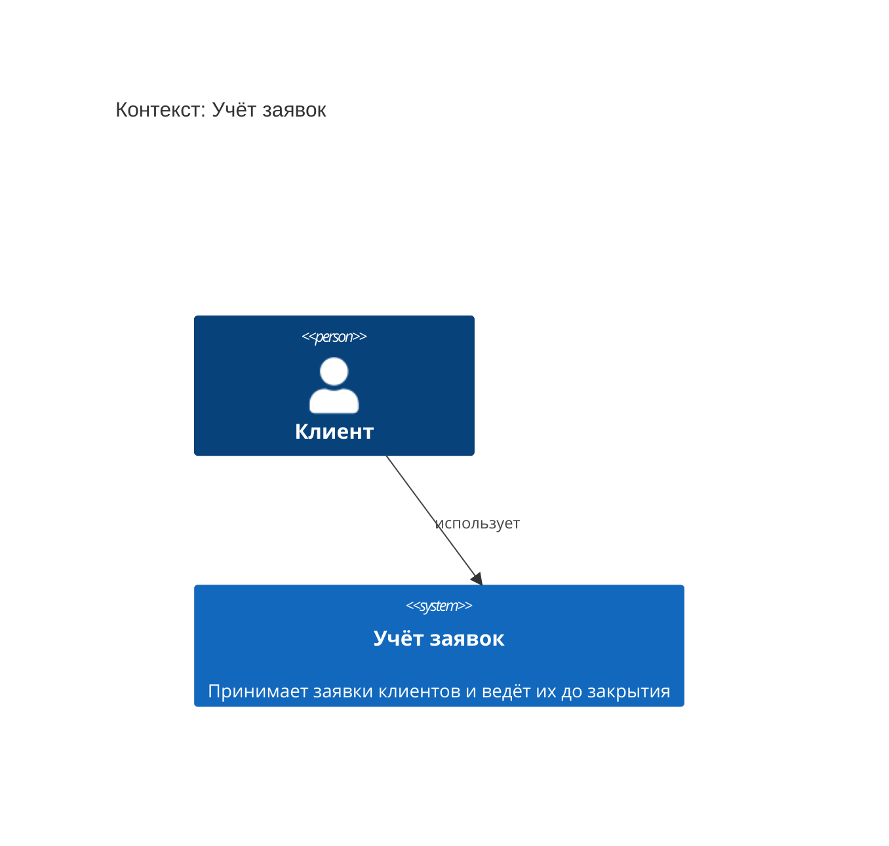

<!-- Сгенерировано командой rivet architecture views. Не редактируй вручную: файл перезаписывается. -->

# Контекст: Учёт заявок

- Контейнеры: [Учёт заявок](container/system.md)

| Элемент | Название | Вид | Технология | Описание |
|---|---|---|---|---|
| `biz.client` | Клиент | человек |  |  |
| `system` | Учёт заявок | система |  | Принимает заявки клиентов и ведёт их до закрытия |
