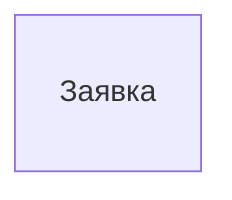

<!-- Сгенерировано командой rivet architecture views. Не редактируй вручную: файл перезаписывается. -->

# Данные: Учёт заявок

Общая схема всех объектов данных описания. По хранилищам: [PostgreSQL](tech.db.md).

## Заявка (`data.request`)

Хранится в: PostgreSQL.

Атрибуты не описаны.
