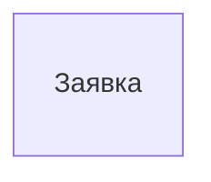

<!-- Сгенерировано командой rivet architecture views. Не редактируй вручную: файл перезаписывается. -->

# Данные: PostgreSQL (`tech.db`)

Объекты данных хранилища и их связи. [Общая схема](all.md).

## Заявка (`data.request`)

Хранится в: PostgreSQL.

Атрибуты не описаны.
