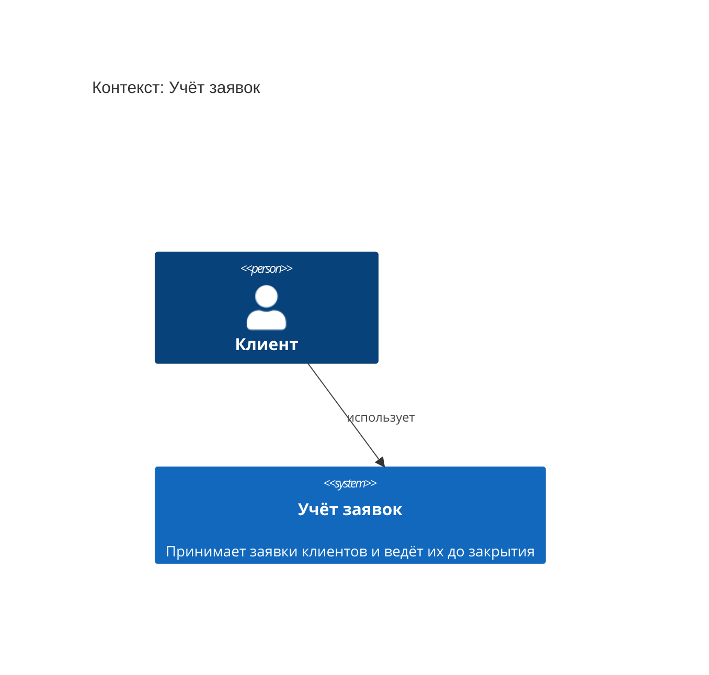
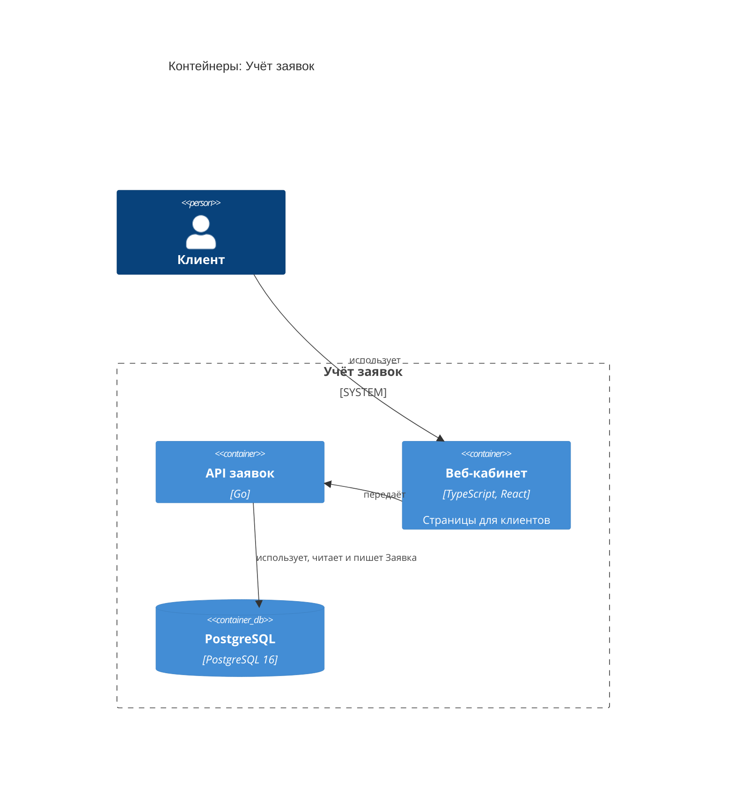
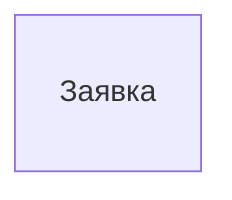

<!-- Сгенерировано командой rivet architecture views. Не редактируй вручную: файл перезаписывается. -->

# HLD: Учёт заявок

Обзор архитектуры верхнего уровня. Документ собран из описания архитектуры, подробности в [C4-схемах](c4/context.md) и [представлениях слоёв](README.md).

## Назначение и принципы

Принимает заявки клиентов и ведёт их до закрытия

| Принцип | Формулировка | Обоснование |
|---|---|---|
| `p.single-source` | У заявки один источник истины | Статус заявки меняет только API заявок |
| `p.web-first` | Клиент работает через веб-кабинет |  |

## Контекст (L1)

Подробнее: [c4/context.md](c4/context.md).

## Контейнеры (L2)

| Контейнер | Вид | Технология | Описание |
|---|---|---|---|
| API заявок (`app.api`) | контейнер | Go |  |
| Веб-кабинет (`app.web`) | контейнер | TypeScript, React | Страницы для клиентов |
| PostgreSQL (`tech.db`) | база данных | PostgreSQL 16 |  |

## Ключевые бизнес-процессы

| Процесс | Участвуют | Представление |
|---|---|---|
| Подача заявки (`biz.request`) | Клиент | [processes/biz.request.md](processes/biz.request.md) |

## Данные

| Объект данных | Читают | Пишут | Хранится в |
|---|---|---|---|
| Заявка (`data.request`) | API заявок | API заявок | PostgreSQL |

ERD: [общая схема](erd/all.md), по хранилищам: [PostgreSQL](erd/tech.db.md).

## Развёртывание

Развёртывание не описано: в слое технологий нет узлов.

## Внешние интеграции

Внешних систем в описании нет.

## Ключевые сценарии

Ключевых сценариев в описании нет.

## Архитектурные решения

Архитектурных решений в описании нет.

## Изменения архитектуры в работе

Изменений в работе нет.
