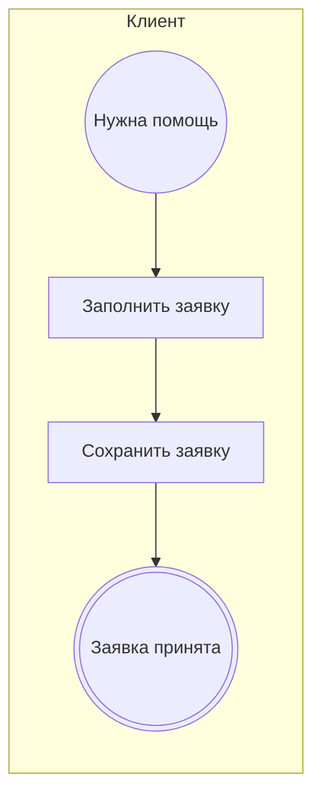

<!-- Сгенерировано командой rivet architecture views. Не редактируй вручную: файл перезаписывается. -->

# Процесс: Подача заявки (`biz.request`)

| Дорожка | Элемент модели |
|---|---|
| Клиент | `biz.client` |

| Сервисная задача | Элемент модели |
|---|---|
| Сохранить заявку | `app.api` |
